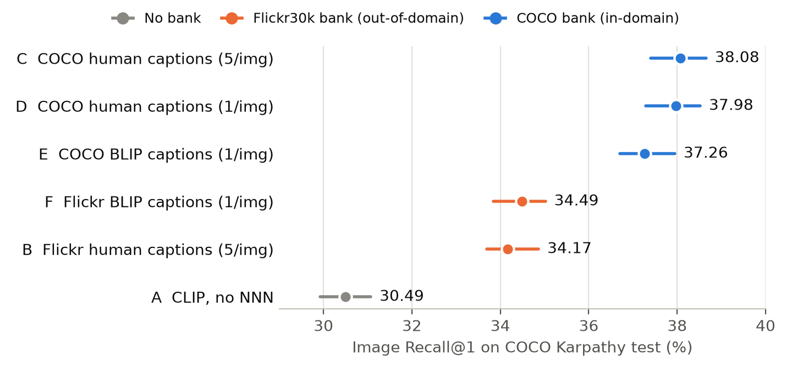

# Can Generated Captions Replace In-Domain Queries? Reference-Bank Domain Mismatch in Nearest Neighbor Normalization

Research project for YZM5110 Multimodal Learning (Fall 2026).

**Paper reproduced:** Nearest Neighbor Normalization Improves Multimodal Retrieval
(https://arxiv.org/abs/2410.24114)

**Question.** NNN reduces hubness in CLIP retrieval by subtracting a per-image bias
computed from a bank of reference queries. The bank works best when it comes from
the target domain. If no real target-domain queries are available, can captions
generated by BLIP from the target-domain images take their place?

## Result (our measurements)

COCO Karpathy test, text-to-image retrieval, 25,010 queries, 5,000 images,
CLIP ViT-B/32. Image Recall@1, mean of 3 seeds.

| Arm | Reference bank | R@1 |
|---|---|---|
| A | none (plain CLIP) | 30.49 |
| B | Flickr30k human captions | 34.17 |
| F | BLIP captions of Flickr30k images (control) | 34.49 |
| **E** | **BLIP captions of COCO images (proposed)** | **37.26** |
| D | COCO human captions, 1 per image | 37.98 |
| C | COCO human captions, 5 per image | 38.08 |

BLIP captions recover about 79% of the accuracy lost when the bank comes from
the wrong domain (Flickr). Confidence intervals, paired bootstrap tests, hubness
measures and the comparison with the paper's published numbers are in
`results/tables/main.md`; the failure analysis is in `results/tables/failure.md`.



## Protocol

- CLIP `openai/clip-vit-base-patch32`; BLIP `Salesforce/blip-image-captioning-base`
  (beam search, 3 beams, max 30 new tokens). Exact revisions in `REUSED_COMPONENTS.md`.
- Preprocessing: default `CLIPProcessor` (resize to 224, center crop, CLIP
  normalisation); image and text embeddings are L2-normalised and cached once.
- Gallery and queries: Karpathy COCO test (5,000 images, 25,010 captions).
- Alpha and k are tuned on Karpathy val only (alpha 0.25-1.5 step 0.125,
  k = 1..512 in powers of two, best R@1); the test set is never used for tuning.
- Reference banks are sampled per image: 22,657 COCO images from Karpathy restval
  (20% of the 113,287 training images, as in the paper) and 5,800 Flickr30k train
  images. Arms C, D and E share the same COCO images, so they differ only in the
  caption source and count.
- Seeds 0, 1, 2 change the bank sample; arm A has no bank and is run once.

Differences from the paper: the bank is drawn from restval (we use only val2014
images), tuning uses Karpathy val instead of a held-out part of the training set,
and the paper does not state its CLIP checkpoint or sampling unit. Our arm A
(30.49) matches the paper's 30.43.

## Setup (Windows, Python 3.12, NVIDIA GPU)

```bat
py install 3.12
py -3.12 -m venv .venv
.venv\Scripts\activate
python -m pip install --upgrade pip
pip install -r requirements.txt --extra-index-url https://download.pytorch.org/whl/cu128
```

Measured on an RTX 5070 Laptop GPU (8 GB); peak GPU memory 5.4 GB (BLIP).

## Quick tests (no data needed, a few seconds)

```bat
python test_nnn.py
python tests\test_nnn_core.py
```

The first checks the environment; the second checks that our NNN code ranks
exactly like the `nnn-retrieval` package.

## Data (not in the repo)

```bat
curl.exe -L -C - -o data\coco\val2014.zip http://images.cocodataset.org/zips/val2014.zip
curl.exe -L -C - -o data\karpathy\caption_datasets.zip https://cs.stanford.edu/people/karpathy/deepimagesent/caption_datasets.zip
curl.exe -L -C - -o data\flickr30k\flickr30k-images.zip https://huggingface.co/datasets/nlphuji/flickr30k/resolve/main/flickr30k-images.zip
```

Extract into `data\coco\val2014\`, `data\karpathy\extracted\` and
`data\flickr30k\flickr30k-images\`.

- COCO val2014 (6.65 GB): https://cocodataset.org/#termsofuse
- Karpathy splits: `dataset_coco.json`, `dataset_flickr30k.json`
- Flickr30k images (4.39 GB): needed only for arm F; research
  use under the Flickr30k terms: https://shannon.cs.illinois.edu/DenotationGraph/

## Full run

```bat
python src\make_splits.py
python src\extract_clip.py
python src\blip_caption.py --seeds 0 1 2
python src\blip_caption.py --dataset flickr --seeds 0 1 2
python src\encode_blip.py --dataset coco
python src\encode_blip.py --dataset flickr
python src\tune.py --arms B C D E F
python src\evaluate.py --arms A B C D E F
python scripts\make_table.py
python scripts\failure_analysis.py
python scripts\make_figures.py
```

Measured times: CLIP features 4.9 min; BLIP 26.4 min for 30,009 COCO images and
12.0 min for 14,151 Flickr images; alpha/k sweep about 4 s per arm and seed.

**Resources.** The quick tests run on CPU without any data. Reproducing the
reported numbers needs the datasets above (about 11 GB) and a CUDA GPU with at
least 6 GB of memory; the full run takes under one hour on the GPU listed in
Setup. `scripts\make_table.py` and `scripts\make_figures.py` rebuild the reported tables
and figures from the saved outputs in `results/` without a GPU or the datasets;
`scripts\failure_analysis.py` also needs the cached features from
`src\extract_clip.py`.

## Layout

| Folder | Contents |
|---|---|
| `src/` | Splits, CLIP and BLIP, NNN, tuning and test evaluation |
| `scripts/` | Tables, figures, failure analysis |
| `tests/` | Small test without data |
| `results/` | Saved results: `splits/`, `tune/`, `test/`, `blip/`, `tables/`, `logs/` |
| `report/` | Report, slides and figures |

## Records

- `report/AI_Usage_Statement.pdf`: use of AI tools
- `REUSED_COMPONENTS.md`: reused code, models and data
